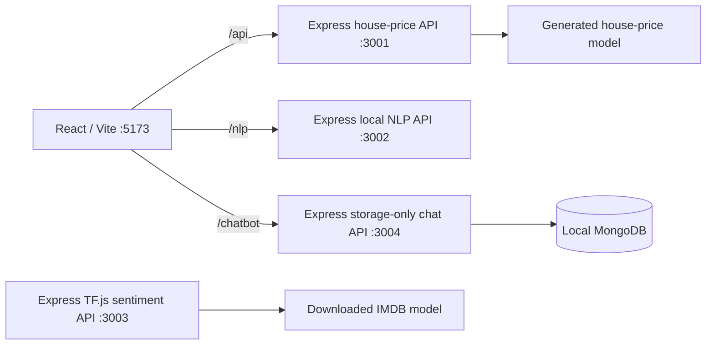
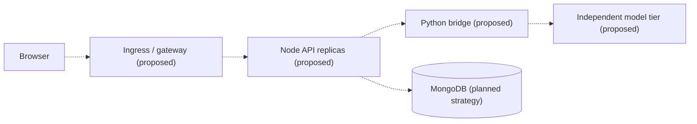
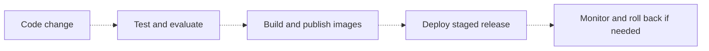

# MERN AI: from local demos to scaling concepts

An interactive course combining a React interface, Express APIs, MongoDB and
TensorFlow.js. Start with [`MERN_AI_Setup.ipynb`](MERN_AI_Setup.ipynb); the
working application lives in [`project-root/`](project-root/).

This is educational software, not a production deployment. Some notebook cells
install dependencies, train models, or write to local MongoDB: read each cell
before running it.

## What exists locally



The sentiment API is a separate example; the Vite configuration does not proxy
it. The chat stores messages but does not generate replies or call Dialogflow.
The notebook discusses Dialogflow ES/CX setup; live integration is not
implemented.

## Course map

- Regression, hyperparameter selection, model saving and structured pruning.
- React supervised/unsupervised demos, predictive text, recommendations and Axios.
- Local MongoDB data modeling and a security lab.
- Express middleware with a real pretrained TensorFlow.js sentiment model.
- Persistent chat, followed by **reference-only** CI/CD, Docker, Kubernetes and
  Python microservice/scaling lessons.

The training datasets are small instructional examples. Earlier lessons exposed
test observations, so their results are not an independent final benchmark.
Sentiment scores are not calibrated confidence estimates.

## Local setup

Prerequisites: Node.js and npm (the notebook was run with Node 22.1), a Python
Jupyter kernel with the packages used by the notebook, and local MongoDB for
the database lessons and chat. Review the notebook's paths and kernel
requirements: Lesson 26 expects the notebook kernel's working directory to be
the repository root and checks for the course's named Conda environment.
Adapt that environment check if you use a different isolated environment.
This publication copy has cleared outputs and metadata; the executed local
notebook is preserved separately.

From the repository root, install each application's dependencies:

```sh
cd project-root/server
npm ci
cd ../client
npm ci
```

Generate the house-price artifact by running the regression and tuning cells in
order; the selected model is written to
`project-root/server/models/tuned-house-price/`. For the sentiment API, run the
model-download cell in Lesson 25, which obtains the TensorFlow.js Examples
IMDB model and metadata from its documented official source. Model artifacts
are excluded from version control.

In separate terminals, from the repository root:

```sh
cd project-root/server && node src/inference-api.cjs  # :3001; requires generated model
cd project-root/server && node src/text-api.cjs       # :3002
cd project-root/server && node src/sentiment-api.cjs  # :3003; requires downloaded model
cd project-root/server && node src/chat-api.cjs       # :3004; requires local MongoDB
cd project-root/client && npm run dev                 # :5173
```

Open <http://127.0.0.1:5173>. Start only the APIs needed for the demos you
want to use. See the [NLP](project-root/server/COURSE-NLP.md),
[sentiment](project-root/server/COURSE-SENTIMENT.md) and
[chat](project-root/server/COURSE-CHAT.md) guides for contracts and limitations.

## Validation

Focused checks, without a build:

```sh
cd project-root/client
node --test src/course-learning.test.js src/chat-client.test.js
cd ../server
node --test src/course-nlp.test.cjs src/text-api.test.cjs src/chat-api.test.cjs
```

For the real MongoDB chat integration check, start a local MongoDB instance and
run `CHAT_MONGO_TEST=1 node --test src/chat-api.test.cjs` from the server
directory. It writes labeled test messages that remain in dedicated lesson
collections; see the chat guide before running it. Sentiment tests additionally
require the downloaded model. Notebook results document prior local checks,
not browser or cloud deployment validation.

A previous dependency audit reported unresolved findings; that historical
result is not a current audit. Review dependencies before reuse.

## Reference architecture—not deployed

The following is a learning target from the notebook, not a checked-in Docker,
Kubernetes, Python or CI/CD implementation.





All release and scaling steps above are proposed examples, not evidence that
images, workflows, clusters or monitoring are configured.
